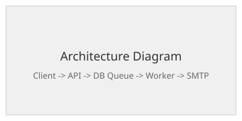
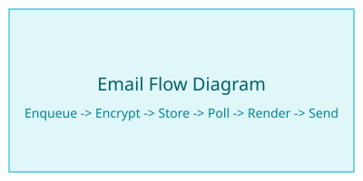

<div align="center">

# Maatify Channel Delivery

<picture>
  <source media="(prefers-color-scheme: dark)" srcset="https://www.maatify.dev/company-profile/maatify_logo_white.svg">
  <source media="(prefers-color-scheme: light)" srcset="https://www.maatify.dev/company-profile/maatify_logo_dark.svg">
  
</picture>

[](https://github.com/Maatify/channel-delivery/releases) [](https://packagist.org/packages/maatify/channel-delivery) [](composer.json) [](LICENSE) [](CONTRIBUTING.md) [](https://github.com/Maatify/channel-delivery/actions/workflows/ci.yml)

[](https://packagist.org/packages/maatify/channel-delivery) [](https://packagist.org/packages/maatify/channel-delivery) [](https://packagist.org/packages/maatify/channel-delivery) [](https://github.com/Maatify) [](#installation)

[Usage Guide](docs/guides/USAGE_GUIDE.md) · [Examples](examples/README.md) · [HTTP Reference](docs/CHANNEL_DELIVERY_API.md) · [Changelog](CHANGELOG.md) · [Security](SECURITY.md) · [Contributing](CONTRIBUTING.md)

Standalone asynchronous email delivery service with encrypted queues, atomic acceptance and isolated no-send recording. Other delivery channels are planned.

</div>

---

**Artifact target: `2.0.0`** — this source tree prepares the project release; HTTP API versioning is separate.

**Publication snapshot at preparation (2026-11-07):** `2.0.0` was unpublished;
`1.1.0` was the verified published release. The badges above report live repository/registry state,
not the identity or qualification of this artifact. See the [2.0.0 release guide](docs/releases/2.0.0.md)
and [upgrade guide](docs/upgrade/2.0.0.md). No release-qualified SHA or publication is claimed by preparation.

## Overview

**Maatify Channel Delivery** is a standalone asynchronous email delivery microservice, designed to accommodate additional channels in future releases.

It offloads delivery processing from your core applications, providing:

- Independent ingestion and worker operation
- Background delivery processing
- Retry mechanisms
- Secure payload encryption
- Controlled API ingestion

The **Email channel is implemented**. Acceptance confirms queue persistence; delivery is processed separately by the worker.
Additional channels such as **SMS, Telegram, and Push notifications** are planned for future releases.

---

Atomic keyed acceptance and receipt lookup are available through the additive
[v2 HTTP API](docs/api/email-atomic.md), using email-delivery 1.2.0.
Follow the [schema/binding rollout](docs/how-to/atomic-email-rollout.md) before enabling v2.
v1 keeps its existing behavior.

The optional [synthetic no-send HTTP endpoint](docs/api/email-synthetic.md) records
encrypted inert data in separate storage. It requires explicit retention and
[bounded cleanup](docs/how-to/synthetic-email-operations.md); no timing-equality promise is made.

## Features

- **Async Email Queue**
  Process notifications asynchronously using background workers.

- **Encrypted Payloads**
  Built-in `AES-256-GCM` encryption for recipients and message contexts via `maatify/crypto`.

- **Template Rendering**
  Uses **Twig** to render dynamic email templates safely.

- **Reply-To Support**
  Optional `reply_to` field for admin notification emails — email goes to the admin, replies go to the customer.

- **Robust Delivery**
  Bounded retry/backoff handling for delivery failures.

- **API Key & IP Whitelisting**
  Secure ingestion endpoints allowing only trusted origin servers.

- **Rate Limiting**
  Redis-backed fixed-window request counter per API key. The existing Redis-unavailable behavior is fail-open.

- **Containerized Dependency Injection**
  Built on **Slim 4 + PHP-DI** for modular and testable architecture.

---

## Architecture

The system operates as an **API ingestion layer combined with background workers**.

Applications enqueue notification jobs via HTTP. Workers then process the queue and deliver messages asynchronously.



The email delivery pipeline is powered internally by the
[`maatify/email-delivery`](https://github.com/Maatify/email-delivery)
library, which provides the rendering, transport abstraction,
and delivery engine.

---

## Email Delivery Pipeline

```
Client Application
↓
Channel Delivery API
↓
Encrypted Queue (Database)
↓
Worker
↓
SMTP Transport
↓
Recipient

```

Detailed processing steps:

1. **Enqueue**
   In this legacy pipeline example, the client calls `/api/v1/email/enqueue`. The additive v2 paths are described below.

2. **Encryption**
   The handler delegates recipient and payload encryption/persistence to `maatify/email-delivery`, using `Maatify\Crypto`.

3. **Persistence**
   Job stored securely in `cd_email_queue`.

4. **Worker Polling**
   `EmailQueueWorker` polls pending jobs.

5. **Template Rendering**
   Context is decrypted and injected into Twig templates.

6. **SMTP Delivery**
   Email is sent via `SmtpEmailTransport`. If `replyTo` was set, a `Reply-To` header is added so replies go to the specified address.



---

## Requirements

- PHP **8.4+** for this 2.0.0 artifact (CI: 8.4 and 8.5); see [upgrade compatibility](docs/upgrade/2.0.0.md)
- MySQL with InnoDB and the PDO MySQL driver; service CI currently exercises MySQL 9.2. MariaDB deployment compatibility needs its own qualification.
- Redis
- SMTP server
- Composer

---

## Public Runtime API

| Entry point | Contract |
| --- | --- |
| `GET /health` | Service/database health; no SMTP-delivery probe |
| `POST /api/v1/email/enqueue` | Legacy per-call insert; `202 queued` |
| `POST /api/v2/email/enqueue` | Atomic acceptance with stable consumer/key identity; `202 accepted` |
| `GET /api/v2/email/receipt` | Same-key receipt recovery; `200` or point-in-time `404` |
| `POST /api/v2/email/synthetic` | Isolated encrypted no-send recording; `202 recorded` |
| API-key / email-worker / synthetic-purge CLI | [Operator commands and configuration](docs/reference/configuration.md) |

The [HTTP reference](docs/CHANNEL_DELIVERY_API.md) links the complete contracts and template fields.
Application classes and vendor internals are implementation details, not a PHP library API.
See [v2 examples](examples/README.md) for same-key recovery and no-send usage.

## Related Projects
- [`maatify/email-delivery`](https://github.com/Maatify/email-delivery) – email delivery engine
- [`maatify/crypto`](https://github.com/Maatify/crypto) – encryption layer

---

## Installation

The published Stable channel is available through the [registry](https://packagist.org/packages/maatify/channel-delivery).
A generic `composer create-project maatify/channel-delivery` follows that channel and does not select an unpublished target.

**Only after exact 2.0.0 publication**, install this artifact with:

```bash
composer create-project --prefer-dist --no-dev maatify/channel-delivery channel-delivery 2.0.0
cd channel-delivery
```

During preparation, use a reviewed source checkout instead:

```bash
git clone https://github.com/Maatify/channel-delivery.git
cd channel-delivery
git checkout <reviewed-commit-or-published-tag>
composer install --no-dev --prefer-dist --no-interaction
```

Do not run the placeholder checkout literally. Use the committed project lock.
[First setup](docs/guides/USAGE_GUIDE.md#first-service-setup) includes the required `.env`, schema,
API key and worker steps. The HTTP document root is **`public/`**, never the repository root.

---

## Configuration

Create the environment configuration file:

```bash
cp .env.example .env
```

Edit `.env` and configure the following variables.

### Application

| Variable        | Description                                            |
| --------------- | ------------------------------------------------------ |
| `APP_ENV`       | Application environment (`development` / `production`) |
| `APP_NAME`      | Name of the service instance                           |
| `SUPPORT_EMAIL` | Support contact email                                  |

---

### Database

| Variable      | Description       |
| ------------- | ----------------- |
| `DB_HOST`     | Database host     |
| `DB_PORT`     | Database port     |
| `DB_DATABASE` | Database name     |
| `DB_USERNAME` | Database username |
| `DB_PASSWORD` | Database password |

Example:

```env
DB_HOST=127.0.0.1
DB_PORT=3306
DB_DATABASE=channel_delivery
DB_USERNAME=root
DB_PASSWORD=secret
```

---

### Encryption (Crypto)

Queue payloads and sensitive data are encrypted using **AES-256-GCM** through `maatify/crypto`.

| Variable               | Description                             |
| ---------------------- | --------------------------------------- |
| `CRYPTO_ACTIVE_KEY_ID` | Identifier of the active encryption key |
| `CRYPTO_KEYS`          | JSON array containing encryption keys   |

Configuration shape only — the placeholder below is deliberately not a usable key.
Replace it with a new private value generated for this installation:

```env
CRYPTO_ACTIVE_KEY_ID=v1
CRYPTO_KEYS='[{"id":"v1","key":"<YOUR_UNIQUE_32_BYTE_SECRET>"}]'
```

Key requirements:

* Key must be **exactly 32 bytes**
* Keys support **rotation**
* Old keys remain for **decryption only**

The following existing format produces 32 ASCII key-material bytes from 16 random bytes (128 bits of randomness); it is not 32 random bytes and is not automatically hex-decoded:

```bash
php -r "echo bin2hex(random_bytes(16));"
```

Use the locally generated **32-character ASCII string** in place of the placeholder
above. Generate a fresh private value for each installation; never copy a published
example key or commit/paste the generated key into source, logs or public messages.
Keep historical keys privately when rotating keys for retained data.

Key requirements:

* Must be **exactly 32 raw bytes** (32 ASCII characters in this example)
* Used as the symmetric encryption key for AES-256-GCM
* Keys support **rotation**

---

### SMTP

SMTP configuration used by the email delivery worker.

| Variable            | Description                     |
| ------------------- | ------------------------------- |
| `MAIL_HOST`         | SMTP server host                |
| `MAIL_PORT`         | SMTP server port                |
| `MAIL_USERNAME`     | SMTP username                   |
| `MAIL_PASSWORD`     | SMTP password                   |
| `MAIL_FROM_ADDRESS` | Default sender email            |
| `MAIL_FROM_NAME`    | Sender display name             |
| `MAIL_ENCRYPTION`   | Encryption type (`tls` / `ssl`) |
| `MAIL_TIMEOUT`      | SMTP timeout (seconds)          |
| `MAIL_DEBUG_LEVEL`  | SMTP debug level (0 = disabled) |

---

### Redis

Redis is used for **rate limiting**.

| Variable                    | Description                               |
| --------------------------- | ----------------------------------------- |
| `REDIS_HOST`                | Redis host                                |
| `REDIS_PORT`                | Redis port                                |
| `REDIS_PASSWORD`            | Redis password (optional)                 |
| `REDIS_DB`                  | Redis database index                      |
| `RATE_LIMIT_MAX_REQUESTS`   | Maximum requests allowed                  |
| `RATE_LIMIT_WINDOW_SECONDS` | Rate limit window duration                |
| `TRUSTED_PROXIES`           | Trusted proxy IPs (for `X-Forwarded-For`) |

Example:

```env
REDIS_HOST=127.0.0.1
REDIS_PORT=6379
RATE_LIMIT_MAX_REQUESTS=100
RATE_LIMIT_WINDOW_SECONDS=60
```

---

## Quick Examples

### Customer-facing email

Enqueue a transactional email (e.g., welcome, OTP, verification) sent **to the customer**:

```bash
curl -X POST http://localhost:8080/api/v1/email/enqueue \
  -H "Content-Type: application/json" \
  -H "X-Api-Key: your_generated_api_key" \
  -d '{
    "entity_type": "user",
    "recipient": "user@example.com",
    "template_key": "welcome",
    "language": "en",
    "sender_type": 1,
    "context": {
      "user_name": "Ahmed",
      "activation_link": "https://example.com/activate?token=abc"
    }
  }'
```

### Admin notification with Reply-To (v1.1.0+)

Enqueue an admin notification where the email goes **to the admin**, and replies go **to the customer**:

```bash
curl -X POST http://localhost:8080/api/v1/email/enqueue \
  -H "Content-Type: application/json" \
  -H "X-Api-Key: your_generated_api_key" \
  -d '{
    "entity_type": "contact_form",
    "recipient": "admin@example.com",
    "reply_to": "customer@example.com",
    "template_key": "admin_notification",
    "language": "en",
    "sender_type": 1,
    "context": {
      "customer_name": "Ahmed",
      "customer_email": "customer@example.com",
      "customer_message": "I need help with my account."
    }
  }'
```

---

## Worker Usage

Run the email worker:

```bash
php scripts/email_worker.php --batch=50 --loop --sleep=5
```

This worker should normally run under a **process manager** like Supervisor or systemd.

See the worker setup guide:

[Run Worker Guide](docs/how-to/run-worker.md)

---

## Documentation

* [Documentation Index](docs/index.md)
* [Usage Guide](docs/guides/USAGE_GUIDE.md)
* [2.0.0 Upgrade Guide](docs/upgrade/2.0.0.md)
* [Configuration / CLI Reference](docs/reference/configuration.md)
* [Atomic v2 Contract](docs/api/email-atomic.md)
* [Synthetic Contract](docs/api/email-synthetic.md)
* [Release Qualification Checklist](docs/releases/RELEASE_CHECKLIST.md)
* [Run Worker Guide](docs/how-to/run-worker.md)
* [Send Email Guide](docs/how-to/send-email.md)
* [API Documentation: Email Enqueue](docs/api/email-enqueue.md)
* [Basic Usage Example](docs/examples/basic-usage.php)

---

## License

This project is open-sourced software licensed under the **MIT License**.

See the [LICENSE](LICENSE) file for details.

## Contributing

Use a source clone and the [contribution guide](CONTRIBUTING.md). Release archives omit test infrastructure.
Please follow the [Code of Conduct](CODE_OF_CONDUCT.md) and report vulnerabilities privately through [SECURITY.md](SECURITY.md).

## Author

Engineered by **Mohamed Abdulalim** ([@megyptm](https://github.com/megyptm))<br>
Backend Lead & Technical Architect<br>
[https://www.maatify.dev](https://www.maatify.dev)

---

<div align="center">

[Built with ❤️ by Maatify.dev — Unified Ecosystem for Modern PHP Libraries](https://www.maatify.dev)

</div>
